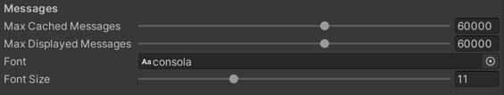
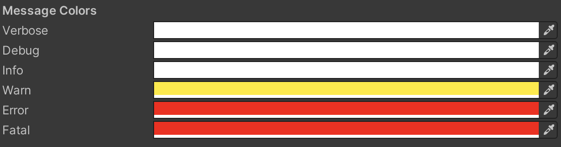
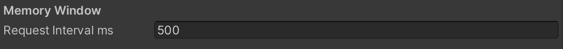
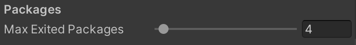
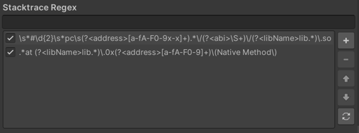
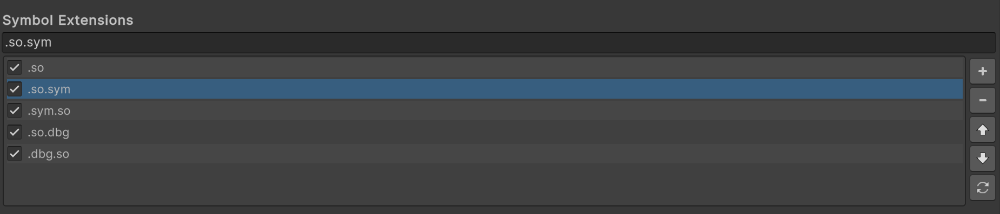

# Android Logcat Settings

Use the Android Logcat Settings window to customize the behavior of the Android Logcat window and tools.

To open the Android Logcat Settings window in the Unity Editor, go to **Edit** > **Preferences** > **Analysis** >  **Android Logcat Settings** (Windows) or **Unity** > **Settings** > **Analysis** > **Android Logcat Settings** (macOS) from the main menu in Unity. The settings are grouped under the following sections:
* [Messages](#messages)
* [Message Colors](#message-colors)
* [Memory Window](#memory-window)
* [Packages](#packages)
* [Capture Settings](#capture-settings)
    * [Recording](#recording)
    * [Live Stream](#live-stream)
* [Stacktrace Regex](#stacktrace-regex)
* [Symbol Extensions](#symbol-extensions)

Use the **Reset** button at the bottom of the Settings window to restore the default settings.

## Messages

Use **Messages** section to customize the appearance and the number of the messages displayed on the Android Logcat window.

|**Setting**|**Description**|
|---|---|
|**Max Cached Messages**|Specifies the maximum number of log messages Unity stores in memory that you can view later in the Logcat window. You can adjust the value as per your need such that it doesn't impact the application performance.|
|**Max Displayed Messages**|Specifies the maximum number of log messages to be displayed in the Logcat window. This value cannot be greater than the value specified in the Max Cached Messages. Increase or decrease the value to make navigating messages easier during debugging.|
|**Font**|Specifies the font for the messages displayed in the Logcat window. You can customize the font to improve readability of the messages.|
|**Font Size**|Specifies the font size for the messages displayed in the Logcat window. You can customize the font size to read the messages conveniently on different screen sizes.|

## Message Colors

Use **Message Colors** setting to customize the color of the log messages displayed in the Android Logcat window. Customizing the colors can help you differentiate between different types of log messages, making it easier for you to identify any issues. You can assign different colors to log messages based on their priorities, such as **Verbose**, **Debug**, **Info**, **Warn**, **Error**, and **Fatal**. For more information about the priority levels, refer to Android documentation on [Filtering log output](https://developer.android.com/tools/logcat#filteringOutput).

To customize the log message color, click anywhere on the swatch displayed next to the log message priority level to open the color picker. On the color picker interface, use slider or text box to set your preferred RGB or Hexadecimal color code. Alternatively, you can set the color you prefer using the **Swatches** option at the bottom of the color picker. For more information about Swatches, refer to <a href="https://docs.unity3d.com/Manual/EditingValueProperties.html#swatch-libraries">Creating swatch libraries</a>.

## Memory Window

Use the **Request Interval ms** setting to specify a time interval to request memory information for the selected application on the connected device. The minimum time interval that you can specify is 500ms.

## Packages

Use the **Max Exited Packages** setting to specify the maximum number for the applications selected in the Package Selector that are now closed. This allows you to restrict the number of entries in the Package Selector dropdown for closed applications to prevent overpopulating the dropdown.

## Capture Settings

Use **Captures Folder** to choose where Unity saves screenshots. Unity names each screenshot after the ID of the device that captured it. The note under the field displays the full path of the folder.

The **Captures Folder** setting accepts a relative or an absolute path:
* A relative path starts at your project folder. The default value `AndroidLogcat/Captures` is a relative path. This path remains valid when you move the project or open it on another computer.
* An absolute path is used for screenshots saved outside the project.

To choose a folder, select **Browse...**. If the folder is inside the project, Unity stores it as a relative path. If the folder is outside the project, Unity stores it as an absolute path.

The default, `AndroidLogcat/Captures`, is a folder in your project, beside `Assets`. It is outside `Assets`, so Unity doesn't import captures or include them in a build. Deleting the `Library` folder doesn't remove the captures folder. Captures in this folder remain until you delete them. Unity's own `.gitignore` file doesn't cover the captures folder. If you don't want captures in source control, add the captures folder to your own `.gitignore` file.

Changing the folder takes effect immediately. Unity doesn't move existing captures to the new folder: they stay in the old folder, and the [Capture list](screen-capture-window-reference.md#capture-list) displays only the captures in the new folder. To keep using earlier captures, move them to the new folder yourself, together with their `.json` files.

### Recording

|**Setting**|**Description**|
|---|---|
|**Time Limit (minutes)**|Specifies how long a recording runs before it stops on its own, between 1 and 60 minutes. The default value is 10.|
|**Square Video**|Records a square video, as wide and tall as the longest side of the stream, so turning the device or unfolding a foldable keeps the picture at full size. When disabled, the video is the size of the screen when recording starts, and a turned or unfolded screen is scaled down to fit. Enabled by default.|
|**Record Touches**|Saves the clicks and drags you send from the live view with a recording. When the recording plays in the Screen Capture window, a marker shows where the screen was touched: green when pressed, blue while dragging, and white, fading, once released, or red if the touch was cancelled. Other video players don't show the markers. Enabled by default.|

### Live Stream

Use the **Live Stream** settings to control the [live view of the device's screen](screen-capture-live-stream.md). Recordings are made from the live view, so these settings also set the size and quality of a recording. Streaming a display uses the device's CPU to compress each frame and the connection to your computer to carry it, so these settings trade image quality for both.

|**Setting**|**Description**|
|---|---|
|**Max Size**|Specifies the longest side of the streamed image in pixels, between 256 and 2048. The device's display is scaled down to fit. The default value is 1024.|
|**JPEG Quality**|Specifies the quality of each streamed frame, between 1 and 100. Lower values produce smaller frames and use less bandwidth. The default value is 70.|
|**Max Frame Rate**|Specifies the highest number of frames per second the device sends, between 1 and 60, and the frame rate recordings are made at. The device only sends a frame when its screen changes, so this is a limit rather than a rate. The default value is 30.|

These settings apply when a stream starts. To apply them to a stream that is already running, turn **Live** off and on again in the [Device Screen Capture window](screen-capture-window-reference.md#capture-list).

Use the **Reset** button in this section to restore the three Live Stream settings without changing any other setting.

## Stacktrace Regex

Use the **Stacktrace Regex** setting to configure regular expressions used for resolving function address and library names. You can add new regular expressions, remove, or disable the existing ones.

From the regular expressions list, the one at the top is used for resolving the function address and library name. If it fails, the next one in the order is used as a fallback. You can modify the order as per your preference.

For more information, refer to [configure stacktrace regular expressions](stacktrace-utility-set-up.md#configure-stacktrace-regular-expressions).

## Symbol Extensions

Use the **Symbol Extensions** setting to specify file extensions which are appended to symbol file names during stacktrace resolving.

For example, if the symbol file name is `libunity` and the specified symbol extensions are `.so.sym`, `.so.dbg`, the Stacktrace Utility tool looks for `libunity.so.sym` and `libunity.so.dbg` symbols.
