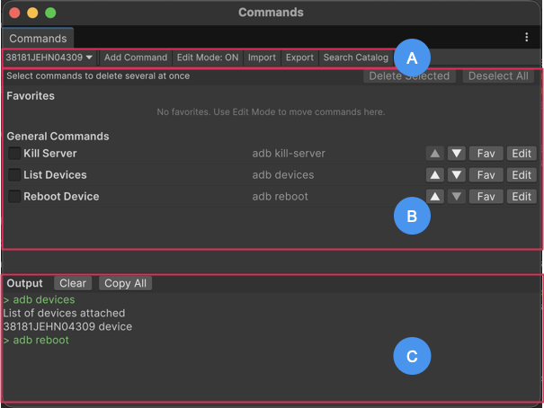

# Commands window reference

Explore the controls and dialogs in the Commands window to run and manage Android Debug Bridge (adb) commands.

The Commands window is a separate window that you can dock. To open it, select **Tools** > **Commands** in the [Android Logcat window](android-logcat-window.md) toolbar. If the Android Build Support module isn't installed, the window displays a message and doesn't list any commands.

When you open the Commands window for the first time, the **General** list contains three default commands: **List Devices**, **Kill Server**, and **Reboot Device**. Unity saves your commands in your user settings, so they persist between Editor sessions.

> The Commands window displaying the toolbar, command lists, and the output panel.

| **Label**                      | **Description**                                              |
| ------------------------------ | ------------------------------------------------------------ |
|  | [Toolbar](#toolbar): Contains controls to add, import, export, and search for commands, and switch to Edit Mode. |
|  | [Command lists](#command-lists): Lists your **Favorites** and **General** commands, with a **Run** button for each command. |
|  | [Output panel](#output-panel): Displays the output of the commands that you run, with an option to copy the output and cancel a running command. |

## Toolbar

The toolbar contains the following controls:

| **Control**        | **Description**                                              |
| ------------------ | ------------------------------------------------------------ |
| **Add Command**    | Opens the [Add Command dialog](#add-command-and-edit-command-dialogs) to create a command. |
| **Edit Mode**      | Turns Edit Mode on or off. In Edit Mode, each command displays controls that you can use to reorder, edit, and delete commands, and mark them as favorites. |
| **Import**         | Replaces your current commands with the commands from a JSON file. |
| **Export**         | Saves your current commands to a JSON file.                  |
| **Search Catalog** | Opens the [Search Commands window](#search-commands-window). |

## Add Command and Edit Command dialogs

The **Add Command** and **Edit Command** dialogs contain the following properties:

| **Property** | **Description**                                              |
| ------------ | ------------------------------------------------------------ |
| **Name**     | Sets the name that the Commands window displays for the command. |
| **Command**  | Defines the command to run. You can enter multiple lines of commands. Each line runs as a separate command in sequence. For example: `adb shell pm clear <package>` `adb shell am start -n <package/activity>`  A line that starts with `adb` runs on the device selected in the Android Logcat window. Unity applies the selected device automatically unless you specify `-s` or `--serial`. Any other line runs as a program on your computer, for example `java -jar bundletool.jar`.  To add a placeholder, enter the name in angle brackets. For more information, refer to [Resolve Placeholders dialog](#resolve-placeholders-dialog).  **Note**: Unity doesn't validate a command. If a command fails, the error appears in the output panel when you run it. For adb syntax, refer to [Android Debug Bridge (adb)](https://developer.android.com/tools/adb). |
| **Category** | Sets the category that the Search Commands window uses to filter the command. The available options are: &#8226; **Uncategorized** &#8226; **Device Management** &#8226; **Packages** &#8226; **Permissions** &#8226; **File Transfer** &#8226; **System Info** &#8226; **Dumpsys** &#8226; **Settings** &#8226; **Networking** &#8226; **Advanced** &#8226; **Quest** &#8226; **Bundletool** |

## Search Commands window

The Search Commands window lists all commands, including the predefined commands in the built-in catalog and the commands that you add through the **Add Command** dialog. Commands that are already in your command list are labeled **Added**. The commands from the built-in catalog are labeled **Catalog**.

| **Control**          | **Description**                                              |
| -------------------- | ------------------------------------------------------------ |
| **Search field**     | Filters the list by command name or command text.            |
| **Category buttons** | Filters the list by category. Select **All** to remove the category filter. |
| **Add**              | Adds a command from the catalog to your list.                |
| **Run**              | Runs a command directly from the Search Commands window without adding it to your command list. |

## Resolve Placeholders dialog

The **Resolve Placeholders** dialog appears when you select **Run** on a command that contains placeholders. A placeholder is a token in angle brackets, such as `<package>` or `<permission>`. For example, the **Clear App Data** command is `adb shell pm clear <package>`.

The **Resolve Placeholders** dialog displays the command and a field for each placeholder. Each field displays an example value. To view a description of the placeholder, hover over the field.

| **Control**            | **Description**                                              |
| ---------------------- | ------------------------------------------------------------ |
| **Placeholder fields** | Enter a value for each placeholder. Unity prefills the `<package>` and `<package/activity>` fields with values from the [Player settings](https://docs.unity3d.com/Manual/class-PlayerSettingsAndroid.html). |
| **▾**                  | Displays a list of common values for the placeholder, such as permissions and Quest levels. The dropdown is available for only some placeholders. |
| **Run**                | Replaces the placeholders with the values that you enter and runs the command. |

## Command lists

This part of the window contains two lists:

* **Favorites**: Commands that you use often.
* **General**: All other commands, including the default commands and commands that you add from the catalog. By default, this section contains three commands: **List Devices**, **Kill Server**, and **Reboot Device**.

Each command has a **Run** button. In Edit Mode, each command also has the following controls:

| **Control**                 | **Description**                                              |
| --------------------------- | ------------------------------------------------------------ |
| **Move up** / **Move down** | Moves the command up or down in the list to change the order that the list displays. Use these controls to move the commands that you use most often to the top. |
| **Fav** / **Unfav**         | **Fav** moves the command from **General** to **Favorites**. **Unfav** moves it back to **General**. |
| **Edit**                    | Opens the [Edit Command dialog](#add-command-and-edit-command-dialogs). |
| **Delete Selected**         | Deletes the selected commands after you confirm. To select a command, select its checkbox. You can delete multiple commands together. |

## Output panel

The output panel displays the output of the commands that you run. It contains the following controls:

| **Control**  | **Description**                                              |
| ------------ | ------------------------------------------------------------ |
| **Copy All** | Copies all output to the clipboard.                          |
| **Clear**    | Clears the output displayed in the output panel.             |
| **Cancel**   | Stops the running command sequence. This control is available only when you run a command. |

## Additional resources

* [Add a command](commands-window-add.md)
* [Android Logcat window reference](android-logcat-window-reference.md)
* [Android Debug Bridge (Android developer documentation)](https://developer.android.com/tools/adb)
