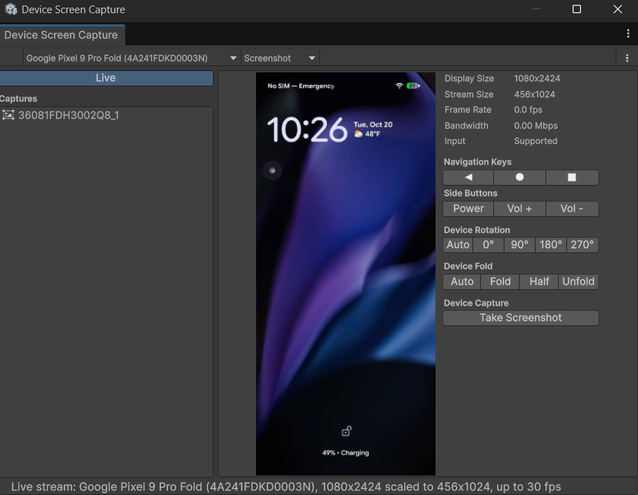

# View the device screen live

This page explains how to use the [Screen Capture tool](screen-capture.md) to view the screen of the connected device as it changes, and how to control the device from the Unity Editor.

The live view mirrors the device's display into the Unity Editor. Unlike a screenshot or a video, Unity doesn't save a live view. The view is live and stops when you select something else.

## View the screen

To view the device screen live:

1. Open the [Device Screen Capture window](screen-capture-window-reference.md).
2. In the [Toolbar](screen-capture-window-reference.md#toolbar), use **Device Selector** to specify the device to view.
3. In the [Capture list](screen-capture-window-reference.md#capture-list), select **Live**. The Screen Capture tool starts streaming and displays the device's screen in the [Capture preview](screen-capture-window-reference.md#capture-preview).

The stream stops when you select another row in the list, close the window, or disconnect the device. Selecting a different device restarts the stream against the newly selected one.

The device only sends a frame when its screen changes, so **Frame Rate** in the [Live view details](screen-capture-window-reference.md#live-view-details) drops to almost nothing while the device shows a still screen. This is expected: the last frame stays on display.

If the stream stops on its own, for example because the device restarted, the [Capture preview](screen-capture-window-reference.md#capture-preview) displays a **Reconnect** button. Select **Reconnect** to restart the stream, or turn **Live** off and on again.

## Control the device

While the live view is streaming, the Screen Capture tool sends your input to the device. **Input** in the [Live view details](screen-capture-window-reference.md#live-view-details) shows whether the device accepts input.

| **Input**                                  | **Result on the device**                                     |
| ------------------------------------------ | ------------------------------------------------------------ |
| Click or drag the image                    | Sends a tap or a swipe at the same place on the device's screen. |
| Scroll the wheel over the image            | Scrolls the content under the pointer.                       |
| Click the image, then press keys           | Sends the keys you press, including **Backspace**, **Enter**, **Tab**, and the arrow keys. |
| **Shift** and an arrow key                 | Extends the selection in a text field on the device, as it would on the device's own keyboard. |
| **Escape**                                 | Sends the Back key.                                          |
| **Ctrl+A**, **Ctrl+C**, **Ctrl+V** (macOS: **Cmd+A**, **Cmd+C**, **Cmd+V**) | Selects all, copies, and pastes on the device, using the device's clipboard. |
| The **◄**, **●**, and **■** buttons         | Sends the Back, Home, and Overview keys. Useful on a device that uses gesture navigation, where the mirrored image has no navigation bar to tap. |
| The **Power**, **Vol +**, and **Vol -** buttons | Sends the Power, Volume Up, and Volume Down keys, which you can't reach through the mirrored screen. The device sends no frames while its screen is off. |
| The **Device Rotation** buttons            | Rotates the device's screen. **Auto** returns rotation control to the device's accelerometer. |
| The **Device Fold** buttons                | Folds and unfolds a foldable device, so that you can view its other display. These buttons appear only for a foldable device. |

The Unity Editor handles other **Ctrl** and **Cmd** combinations, so its own shortcuts continue to work while the image has focus. To zoom the view instead of scrolling the device, press **Ctrl** (macOS: **Cmd**) and scroll over the image. For more information, refer to [Zoom into the image](screen-capture-window-reference.md#zoom-into-the-image).

An app that locks its orientation doesn't rotate with the device. In this case, the live view rotates the image instead, so the rotation is still visible. The device's screen keeps the app's rotation.

> [!NOTE]
> The device's clipboard and your computer's clipboard don't exchange content. **Ctrl+C** copies content on the device and **Ctrl+V** pastes that content on the device.

## Change the size, quality, and frame rate

Streaming a display uses the device's CPU to compress each frame, and the connection to your computer to transfer it. To reduce CPU usage or bandwidth, use the [Live Stream](android-logcat-settings.md#live-stream) settings. To open these settings, go to **Edit** > **Preferences** > **Analysis** > **Android Logcat Settings** (macOS: **Unity** > **Settings** > **Analysis** > **Android Logcat Settings**).

The settings apply when a stream starts. To apply them to a stream that is already running, select **Reconnect** in the live view, or turn **Live** off and on again.

> [!NOTE]
> If you connect the device with `adb connect` instead of USB, the stream shares the device's Wi-Fi connection with other adb tasks, including the message log. If the connection is slow, lower **Max Size** and **Max Frame Rate**, or connect the device by USB.

## Additional resources

* [Device Screen Capture window reference](screen-capture-window-reference.md)
* [Capture a screenshot](screen-capture-screenshot.md)
* [Capture a video](screen-capture-video.md)
* [Connect to a device](connect-to-a-device.md)
