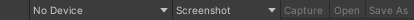

# Device Screen Capture window reference

This page introduces the Device Screen Capture window's interface.

To open the Device Screen Capture window, from the main menu in Unity select **Window** > **Analysis** > **Android Screen Capture**.

You can also open it from the Android Logcat window:

1. Open the [Android Logcat window](android-logcat-window.md).
2. From the [toolbar](android-logcat-window-reference.md#toolbar), select **Tools** > **Screen Capture**.

The Device Screen Capture window contains the following areas.

| **Area**                                | **Description**                                              |
| --------------------------------------- | ------------------------------------------------------------ |
| [Toolbar](#toolbar)                     | Contains options for the Device Screen Capture window.       |
| [Capture list](#capture-list)           | The live view and every capture you have taken. Drag the divider to resize it. |
| [Capture preview](#capture-preview)     | The screenshot, recording, or live view that you select in the list. |
| [Capture details](#capture-details)     | Information about the selected screenshot or recording.      |
| [Live view details](#live-view-details) | Information about the live stream, and the device controls.  |
| [Status bar](#status-bar)               | Where the last screenshot or video was saved.                |

## Toolbar

The toolbar contains options to control the Screen Capture tool.

> The Device Screen Capture window toolbar.

| **Toolbar option**      | **Description**                                              |
| ----------------------- | ------------------------------------------------------------ |
| **Device Selector**     | Specifies the Android device to capture the screen of.       |
| **Advanced**            | Opens a menu with **Preferences**, which contains the capture settings. |

## Capture list

The capture list contains the **Live** button and every capture you have taken from every device. Select **Live** to mirror the device's screen, or select a capture to display it in the [Capture preview](#capture-preview). The **Up Arrow** and **Down Arrow** keys move through the captures. Drag the divider between the list and the preview to resize the list.

| **Item**           | **Description**                                              |
| ------------------ | ------------------------------------------------------------ |
| **Live**           | Displays the selected device's screen live. Select **Live** to view the screen, take screenshots, and record videos. For more information, refer to [View the device screen live](screen-capture-live-stream.md). |
| A capture          | A screenshot or a recording, named after its file without its extension, with an icon that shows which it is. Captures are saved as you take them, so every one stays until you delete it. Selecting a recording opens it in the [Capture preview](#capture-preview), paused on its first frame. |

Captures are stored in the folder set by [Captures Folder](android-logcat-settings.md#capture-settings), and are named `<device id>_<number>` with a `.png` or `.mp4` extension. The default folder, `AndroidLogcat/Captures`, is in your project but outside `Assets`, so it isn't part of your build. Deleting the `Library` folder doesn't delete captures.

The following table describes the actions you can perform in the capture list.

| **Action**                                | **Result**                                              |
| ----------------------------------------- | ------------------------------------------------------- |
| Select a row                              | Selects that capture and displays it in the [Capture preview](#capture-preview). |
| **Shift**+click a row                     | Extends the selection from the last row you clicked. |
| **Ctrl**+click a row (macOS: **Cmd**+click) | Adds a capture to the selection, or removes it. |
| Press **Ctrl+A** (macOS: **Cmd+A**)       | Selects every capture. |
| Double-click a row                        | Opens the capture in the application associated with its file type. |
| Press **Delete** (macOS: **Cmd+Backspace**) | Deletes every selected capture from disk, after asking you to confirm. |
| Right-click a row                         | Opens a menu with **Show In Explorer** (macOS: **Show In Finder**), **Open**, **Copy To...**, **Rename**, **Delete**, and **Select All**. **Show In Explorer**, **Open**, and **Rename** act on the row you clicked and are unavailable while several captures are selected. **Copy To...** and **Delete** act on the whole selection: copying one capture asks for a name, copying several asks for a folder to put them in. |
| Press **F2** (macOS: **Enter**)           | Renames the selected capture. **Enter** confirms the new name and **Escape** cancels. |

To empty the list, select every capture with **Ctrl+A** (macOS: **Cmd+A**) and press **Delete**.

> [!NOTE]
> Renaming a screenshot to something other than `<device id>_<number>` keeps it in the list, but it no longer counts towards that device's numbering.

## Capture preview

This section displays what you select in the [Capture list](#capture-list): a screenshot, a recording, or the live view of the device's screen. You can use this to check the quality of the screen capture before you save it as a file on your computer.

### Zoom into the image

A screenshot and the live view are both fitted to the window, which can be too small to read a log line or see a single pixel. To look closer:

| **Action**                                             | **Result**                                                   |
| ------------------------------------------------------ | ------------------------------------------------------------ |
| **Ctrl**+scroll (macOS: **Cmd**+scroll) over the image | Zooms between 100% and 4000%, around the pointer, so whatever you point at stays where it is. The current zoom appears in the corner of the image while it is above 100%. |
| **Ctrl**+drag with the left or middle mouse button (macOS: **Cmd**+drag) | Moves the zoomed image, to bring another part of it into view. |
| The scrollbars                                         | Moves the zoomed image. The scrollbars appear as soon as the image is larger than the preview area. |

Zooming and moving the image only change how you see it. In the live view, the device still receives your clicks, drags, and keys at the place on its screen you are pointing at, and scrolling without **Ctrl** still scrolls the device rather than the view.

The zoom of the live view and the zoom of the screenshots are separate, and both go back to 100% when scripts recompile.

## Capture details

This section appears beside the image while a screenshot or a recording is selected.

| **Property**       | **Description**                                              |
| ------------------ | ------------------------------------------------------------ |
| **Device**         | The device the capture was taken from. Hover over it for the device ID. |
| **OS**             | The Android version and API level the device was running.    |
| **Display Size**   | The device's display resolution when the capture was taken. This differs from **Image Size** if the display was rotated or its size overridden. |
| **Image Size**     | The size of the image in pixels. Screenshots only.           |
| **Video Size**     | The size of the recording in pixels, which is what the **Video Size** setting asked for. Recordings only. |
| **File Size**      | The size of the file on disk.                                |
| **Captured**       | When the file was last written. Hover over it for the full date and time. |

**Device**, **OS**, and **Display Size** come from the details file, saved in the same folder as the capture. These properties display `Undefined` if a capture was taken with an earlier version of this package, or if the file was added to the folder by hand. **Video Size** comes from the recording itself, so it displays `Undefined` until the recording has opened.

A selected recording opens paused on its first frame, and loops once it plays. Use the play button below the properties to play and pause it. While it is paused, the buttons beside the play button go back or forward one frame. You can also drag the slider under it to move to another frame, whether the recording is playing or paused. A playing recording pauses while you drag, and plays on from the new frame when you let go. The number beside the slider is the current frame and the total number of frames. A recording only gets a new frame when the screen changes, so some frames follow the previous one very closely. The preview can't show such a frame on its own, so stepping skips it and the frame number jumps by two.

## Live view details

This section appears beside the image while **Live** is selected.

| **Property**    | **Description**                                              |
| --------------- | ------------------------------------------------------------ |
| **Display Size** | The resolution of the display being mirrored. Compare it with **Stream Size** to see how much the stream is scaling down. It follows the device, so it changes when the device is rotated or a foldable is opened. |
| **Stream Size** | The size of the streamed image. This is the device display scaled down to fit the **Max Size** setting, not the device's own resolution. |
| **Frame Rate**  | How many frames per second are arriving. The device only sends a frame when its screen changes, so a device showing a still screen sends almost none. |
| **Bandwidth**   | How much data per second is arriving from the device.        |
| **Input**       | Whether the device accepts the touch, scroll, and key events this window sends it. Devices that refuse input injection still stream. |

The device navigation buttons work while the live view is streaming and the device accepts input:

| **Button** | **Description**                                              |
| ---------- | ------------------------------------------------------------ |
| **◄**      | Sends the Back key. The **Escape** key does the same once you click the image. |
| **●**      | Sends the Home key.                                          |
| **■**      | Sends the Overview (recent apps) key.                        |

**Side Buttons** sends the hardware keys that the mirrored screen can't reach:

| **Button**  | **Description**                                              |
| ----------- | ------------------------------------------------------------ |
| **Power**   | Sends the Power key, which turns the screen off. The device sends no frames while its screen is off, so the view stops updating until you select **Power** again. |
| **Vol +**   | Sends the Volume Up key.                                     |
| **Vol -**   | Sends the Volume Down key.                                   |

**Device Rotation** rotates the device's screen:

| **Button**  | **Description**                                              |
| ----------- | ------------------------------------------------------------ |
| **Auto**    | Returns rotation control to the device's accelerometer.      |
| **0°**      | Locks the device to its natural orientation.                 |
| **90°**     | Locks the device rotated 90°.                                |
| **180°**    | Locks the device rotated 180°.                               |
| **270°**    | Locks the device rotated 270°.                               |

**Device Fold** folds and unfolds a foldable device without touching it, so that you can view its other display. These buttons appear only for a foldable device.

| **Button**  | **Description**                                              |
| ----------- | ------------------------------------------------------------ |
| **Auto**    | Returns fold control to the device's hinge.                  |
| **Fold**    | Holds the device folded, regardless of the hinge position.   |
| **Half**    | Holds the device half open, regardless of the hinge position. Appears only for devices that report half open as a separate state. |
| **Unfold**  | Holds the device unfolded, regardless of the hinge position. |

Under **Device Capture**, **Take Screenshot** captures the device screen and adds it to the [Capture list](#capture-list). **Ctrl+Shift+S** (macOS: **Cmd+Shift+S**) does the same while this window has focus and **Live** is selected. The shortcut has no effect while a saved capture is selected. **Take Recording** starts recording the device screen and changes to **Stop Recording**. The recording is added to the list when it stops. The [Capture list](#capture-list) is disabled while recording. Closing the window also stops the recording, so a recording never continues out of sight. Screenshots and recordings are taken on the device rather than copied from the stream, so they are full resolution regardless of how the stream is scaled. The recorder settings are in [Preferences](android-logcat-settings.md#capture-settings).

For how to interact with the device and how to change the size, quality, and frame rate of the stream, refer to [View the device screen live](screen-capture-live-stream.md).

## Status bar

The status bar reports what the window last did:

* Where a capture was written, for example `Screenshot saved to AndroidLogcat/Captures/<device id>_1.png`. A path inside your project is shown relative to it.
* What the live view is streaming, once its first frame arrives, for example `Live stream: Google Pixel 7 Pro (36081FDH3002Q8), 1080x2340 scaled to 232x512, up to 15 fps`. It is reported again when the streamed size changes, which happens when the device is rotated or a foldable is opened, and `Live stream stopped` when it ends.

Every capture is kept until you delete it, screenshots and recordings alike, in the folder set by [Captures Folder](android-logcat-settings.md#capture-settings).

## Additional resources

* [Capture a screenshot](screen-capture-screenshot.md)
* [Capture a video](screen-capture-video.md)
* [View the device screen live](screen-capture-live-stream.md)
* [Android Logcat Settings](android-logcat-settings.md#live-stream)
